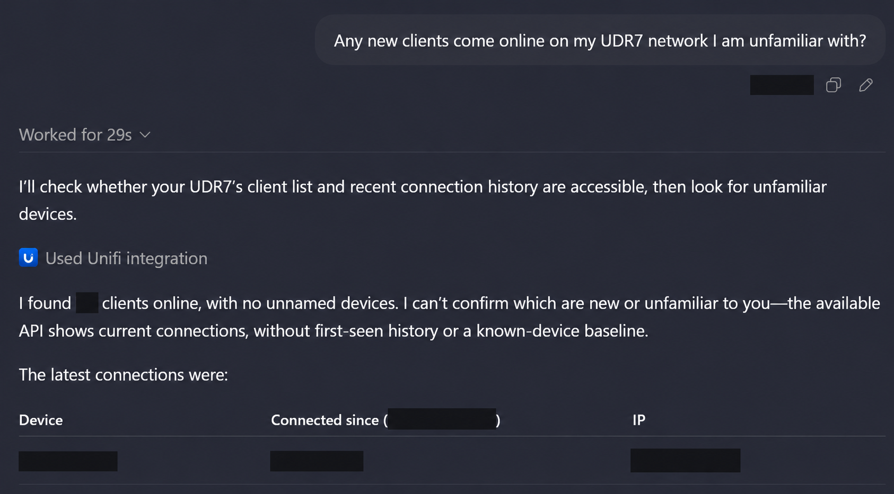
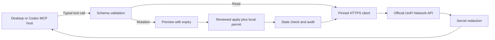

<div align="center">
  
  <h1>UniFi Secure MCP</h1>
  <p><strong>Your network. Structured tools. Deliberate changes.</strong></p>
  <p>A local MCP bridge to the official UniFi Network API, built with the UDR7 in mind.</p>
  <p>
    
    
    
    
    
  </p>
  <p><a href="docs/SETUP.md">Setup</a> · <a href="docs/OPERATIONS.md">All operations</a> · <a href="SECURITY.md">Security</a> · <a href="docs/API-VS-UI.md">API vs UI</a> · <a href="docs/AUDIT.md">Audit</a></p>
</div>

## Ask your network a question



*Edited, privacy-redacted illustration from an actual conversation. Device details, addresses, counts and timestamps are hidden. The response explicitly distinguishes current connections from unavailable first-seen history.*

## What you get

- **Complete coverage of the bundled Network 10.6.106 specification:** 41 reads and 32 mutation operations, each exposed as a named, validated MCP tool.
- **Read-only execution by default.** Mutation tools prepare five-minute previews. Execution additionally requires write-capable setup, a short-lived operation/site permit, and explicit review.
- **Local credentials and pinned TLS.** Hidden key input; Windows current-user DPAPI; no credential tool arguments, public MCP endpoint, telemetry, or browser automation.
- **MCP tools, resources, and prompts.** Structured JSON results, descriptive schemas, annotations, capability discovery, troubleshooting prompts, and safe Mermaid inventory output.
- **A standard local installation.** Official MCP SDK, locked dependencies, STDIO transport, example configurations, tests, CI, and operator documentation.

This project is an **unofficial integration**, unaffiliated with Ubiquiti or OpenAI. “Secure” describes its design, not a guarantee or independent certification. Read [the limits and threat model](SECURITY.md) before enabling writes.

## Install

### 1. Prerequisites and repository access

- Node.js **24 or newer**, including npm (`node --version` and `npm --version`).
- Git, plus access to this private repository. Sign in to the authorized GitHub account if the repository page shows a login screen or 404.
- Local HTTPS access to your UniFi console and a supported Network application. This release targets **UDR7 / Network 10.6.106**.
- A dedicated, expiring UniFi API key created through UniFi's trusted local setup workflow. Prefer restricted permissions when available.
- On Windows: built-in Windows PowerShell for DPAPI. PowerShell 7 is needed only for the optional installation-hardening script. Tests additionally need OpenSSL; Git for Windows normally supplies it.

### 2. Clone and install locked dependencies

Copy this repository's SSH or HTTPS clone URL using GitHub's **Code** button, then clone it into a directory owned by your account. Alternatively, with authenticated GitHub CLI, replace `OWNER` with this repository's owner:

```sh
gh repo clone OWNER/unifi-secure-mcp
cd unifi-secure-mcp
npm ci --ignore-scripts
```

`gh` is optional; normal `git clone` works too. Do not embed a GitHub token in a clone URL. This package is **not published to npm**: use this trusted checkout, not an unverified similarly named `npx` package.

### 3. Enroll the router securely

Run these commands from the checkout in your own interactive terminal:

```sh
npm run setup
npm run verify
```

The interactive setup walks through the router address, independent certificate fingerprint verification, hidden API-key entry, and read-only/write-capable selection. It verifies a read before activating new configuration. Keep the default read-only selection initially.

The default private config is `~/.unifi-secure-mcp/config.json`, outside the checkout. On Windows, the key is encrypted with current-user DPAPI. On macOS/Linux it is stored in an owner-only file; use OS encryption for stronger at-rest protection. **Never paste a key into a conversation or put it in host configuration.**

### 4. Register with desktop / Codex

Add this to your local `~/.codex/config.toml`, replacing the example installation paths with your actual absolute paths:

```toml
[mcp_servers.unifi]
command = 'C:\Program Files\nodejs\node.exe'
args = ['C:\Tools\unifi-secure-mcp\src\cli.mjs', 'serve']
startup_timeout_sec = 45
tool_timeout_sec = 120

[mcp_servers.unifi.tools.unifi_apply_plan]
approval_mode = 'prompt'
```

This uses the default private config created by setup. To use a custom config, append `'--config', 'ABSOLUTE_CONFIG_PATH'` to `args`. On macOS/Linux use absolute POSIX paths for Node and the entry point. The [official OpenAI documentation](https://learn.chatgpt.com/docs/extend/mcp) describes shared local configuration across the desktop app, Codex CLI and IDE extension. Hosted web/Work sessions require separately supported local access; local configuration does not automatically expose this server to the cloud.

Other compatible MCP hosts can use [examples/mcp.json](examples/mcp.json). Choose **STDIO**, not HTTP. Keep credentials out of the host configuration.

### 5. Restart and verify

Restart the UniFi server in your host's **Settings → MCP servers**. Existing processes or conversations can retain old tools until restarted. Call `unifi_status`: expect readiness and read-only access. Then use `unifi_api_get_info` for a small live read. `npm run verify` independently checks the MCP connection and capabilities without querying the router.

After installation, protect source and dependencies from less-trusted users. Windows PowerShell 7 users can run `scripts/harden-install.ps1` from outside the checkout; read [the permissions and setup guide](docs/SETUP.md) first. This restricts the installation to the current user, SYSTEM and administrators.

For certificate changes, key rotation, restricted toolsets, write permits, secret slots, errors and recovery, see the complete [setup guide](docs/SETUP.md).

## How requests travel



There is no arbitrary URL, raw HTTP, shell, or browser tool. Tools are generated from the bundled official schema and inputs are validated again before transmission. A request outside the supported API produces an explicit limitation.

## Coverage

| Area | Capabilities in the pinned API |
| --- | --- |
| Devices and clients | Inventory, details, current statistics, adoption/removal, device and port actions, guest access actions |
| Networks and Wi-Fi | Network/VLAN and Wi-Fi broadcast reads, creation, updates, deletion, network references |
| Security policies | Firewall zones/policies/order, ACL rules/order, DNS policies, traffic matching lists |
| Hotspot | Voucher reads, creation and removal |
| Supporting objects | WAN definitions, VPN information, RADIUS profiles, tags, DPI categories/apps, countries |
| Switching | Stack, MC-LAG and LAG information; hardware support varies |

See [all 73 operations](docs/OPERATIONS.md). Coverage means the documented operations are implemented and registered; it does **not** mean every one has been exercised on production equipment. Not every UI setting has an official API, and a UDR7 cannot supply features that require other hardware.

## Controlled writes

1. Choose `write-capable` during local setup. Execution still starts read-only.
2. Use the relevant `unifi_api_*` mutation tool to prepare a preview.
3. Review its exact request, current state, risk, and recovery requirements.
4. In your own terminal, grant a brief permit for the specific operation and site.
5. Approve `unifi_apply_plan` with the plan ID and exact confirmation phrase.
6. Read back the affected configuration and revoke the permit.

Example with documentation-only placeholders:

```sh
node src/cli.mjs permit --site SITE_UUID --operation updateNetwork --minutes 15
node src/cli.mjs revoke
```

Permit creation is intentionally absent from the MCP toolset. Previews are single-use and expire after five minutes; permits expire within at most one hour. Deletes, restarts, port actions and network/security changes can interrupt access or be irreversible. No automatic rollback or write retry is promised.

## Honest diagnostics

The local API exposes **latest** device statistics, not a historical WAN outage log. Router uptime can show that a device has not restarted; it cannot prove uninterrupted internet or Wi-Fi. This MCP reports that gap instead of falling back to an undocumented endpoint or browser.

Mermaid output is a bounded **logical inventory**, not a guaranteed physical cable map. Render it with Mermaid's strict security mode. The host decides whether to display the diagram or its source.

## Verification and maintenance

```sh
npm test
npm run check
npm run privacy
npm audit
```

Tests use synthetic data and a local HTTPS simulator. The representative write test restores its simulated configuration. An optional authorized `node scripts/verify.mjs --live` performs a small set of reads through a real MCP client; it does not execute mutation operations. See [testing and recovery](docs/TESTING.md).

## Upgrade or remove

Before an upgrade, revoke local permits with `node src/cli.mjs revoke` and stop the MCP server in the host. Review the changes, run `git pull --ff-only`, `npm ci --ignore-scripts`, `npm run check`, and `npm test`. Recheck installation permissions, restart the server, and verify status. Keep private configuration outside the checkout; do not overwrite it with `config.example.json`. Back it up only to protected local storage if needed.

To remove the integration, stop the MCP server, remove its host configuration entry, and revoke its dedicated API key in UniFi. You can then remove the checkout and its separate private configuration/storage after deciding whether private audit records must be retained. Removing the local server alone does not revoke the UniFi key.

## Design references

The configuration and documentation were informed by [GitHub's MCP server](https://github.com/github/github-mcp-server/blob/main/docs/server-configuration.md), [Context7](https://github.com/upstash/context7/blob/master/packages/mcp/README.md), and the [official MCP reference servers](https://github.com/modelcontextprotocol/servers). The implementation is specific to this project; these references do not endorse it.

Original code is MIT licensed. The UniFi icon and upstream specification retain their respective rights; see [third-party notices](THIRD-PARTY-NOTICES.md). Static badges describe design facts, not a certification or live test result.
